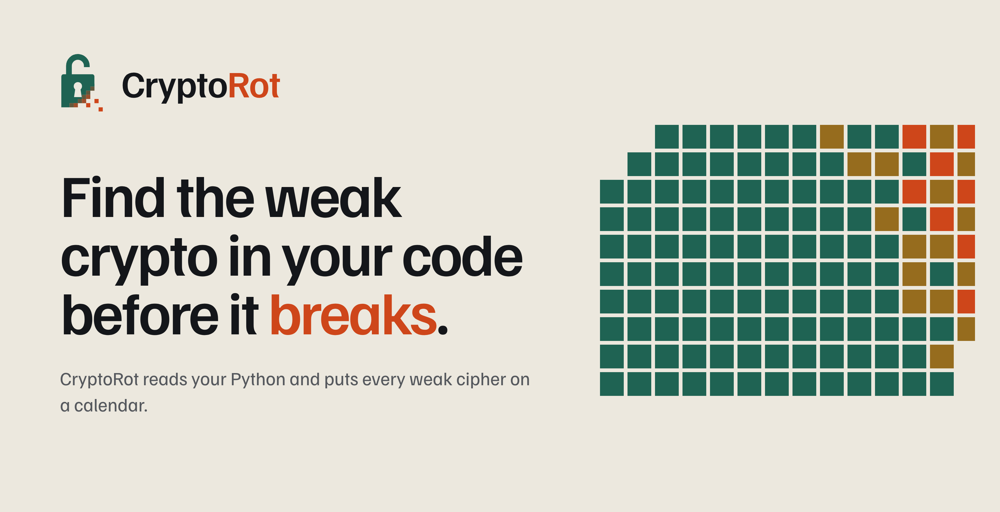
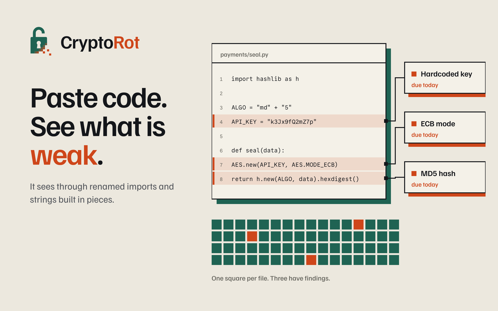
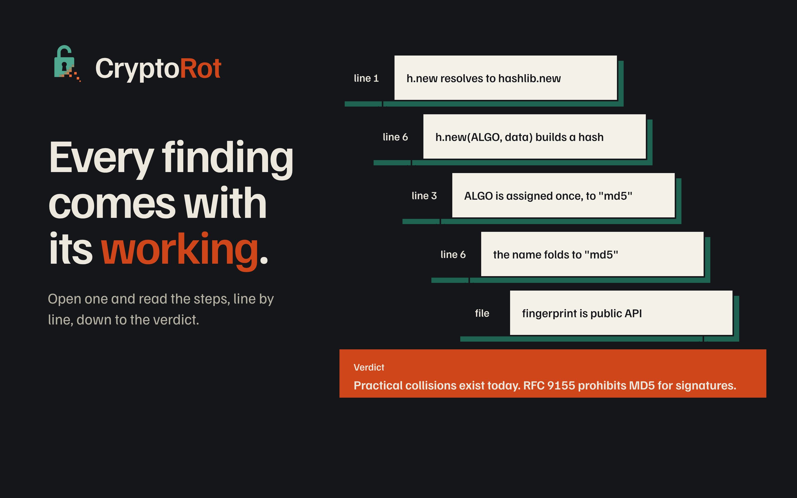
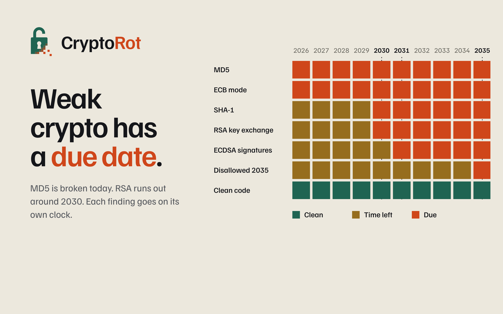
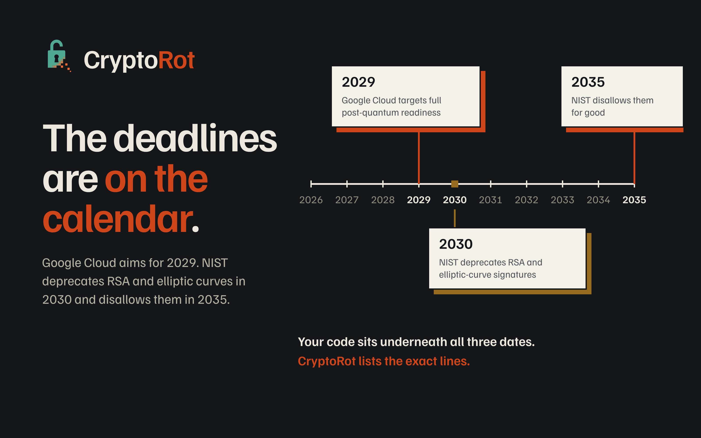
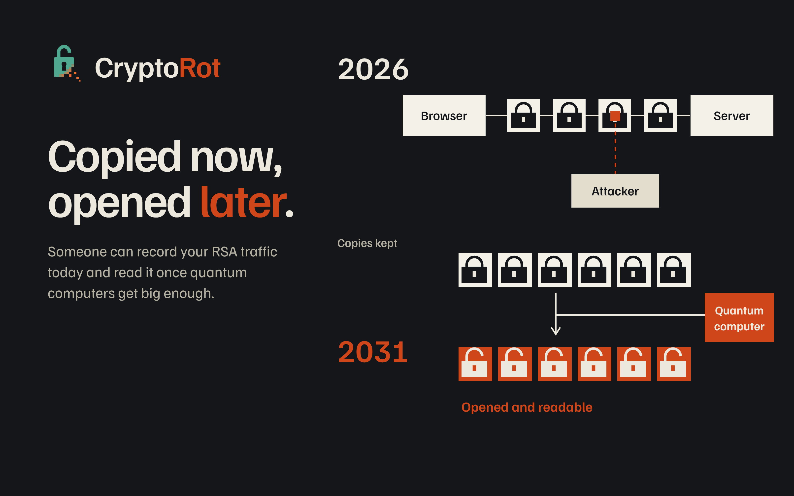
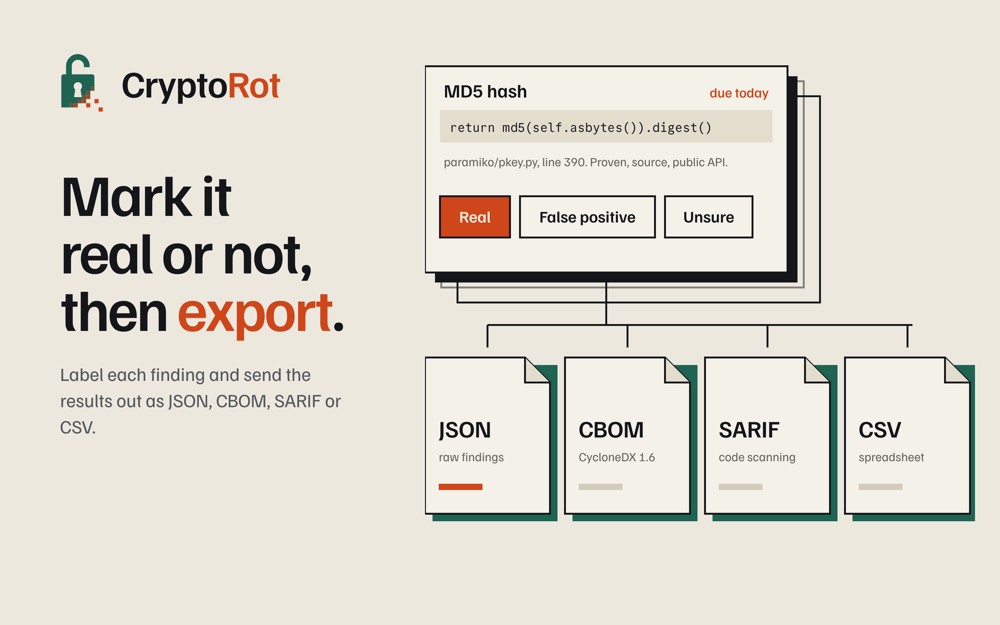
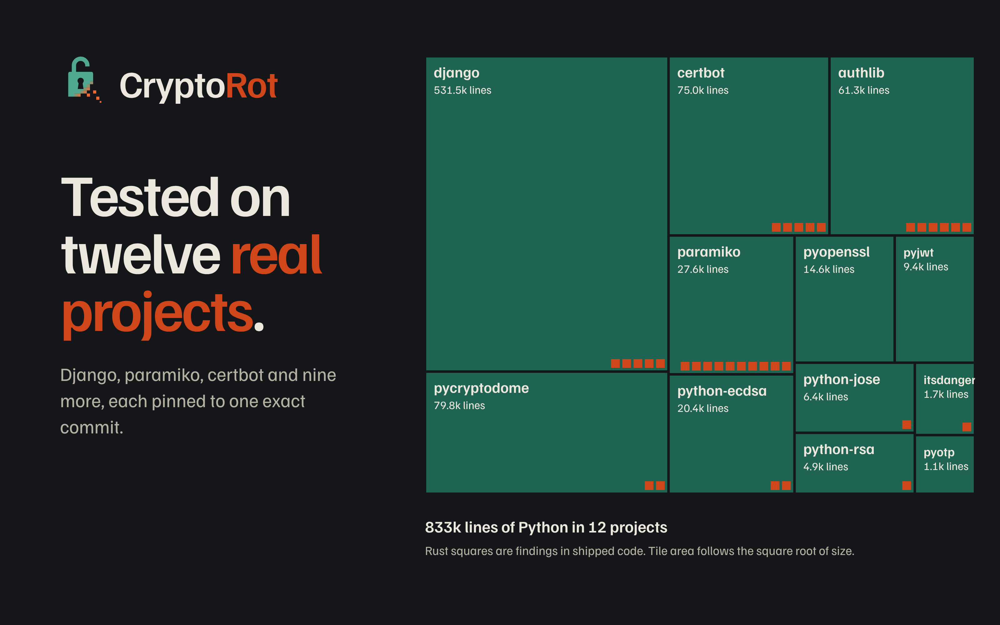
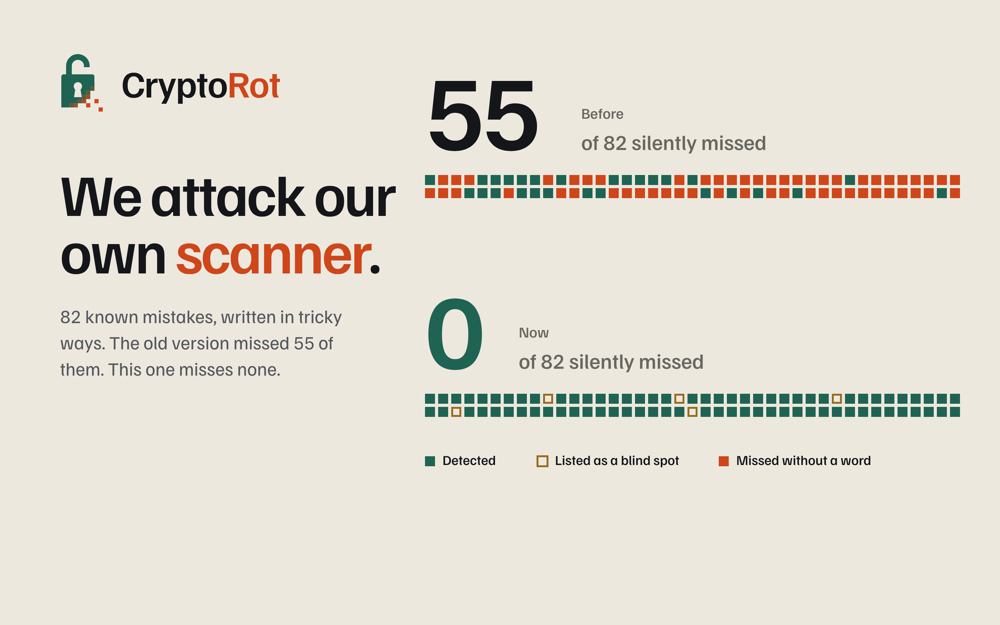

<p align="center"></p>

CryptoRot is a static analyzer for Python that finds weak or soon-to-be-retired cryptography and puts each finding on a calendar. Every finding gets a due year and a cited source, not a score.

Organizations moving to post-quantum cryptography start with an inventory of where crypto lives in their code. CryptoRot builds that inventory from the AST, exports it as a CycloneDX CBOM, and shows how much of it will need to change, and when.

<p align="center"> </p>
<p align="center"> </p>

## What it does

- Resolves calls through the Python `ast`: import aliases, constant folding, keyword arguments, `getattr`, and one-hop parameter propagation.
- Flags weak hashes, ECB mode, hardcoded keys, short RSA/EC keys, and quantum-vulnerable public-key use.
- Reports three clocks per finding: now, policy (2030), and quantum (2031 to 2035).
- Separates harvest-now-decrypt-later exposure from forgery-later exposure.
- Labels each finding proven, probable or heuristic, and tags it source, test or example.
- Declares its blind spots instead of hiding them.
- Exports JSON, CycloneDX 1.6 CBOM, SARIF 2.1.0 and CSV.

<p align="center"> </p>

## Run it

```
python3 engine/cli.py path/to/project
```

The dashboard talks to a scan service (`server/`) that runs the engine. The page itself ships no rules or scoring. Set `CR_API` to the service URL when building the page.

```
CR_API=https://your-service python3 web/build.py   # writes public/index.html
uvicorn app:app --app-dir server               # run the service
```

`public/` is a static site and deploys as is (`vercel.json` is included).

## Benchmark

Twelve open-source Python projects, pinned by full commit SHA in `bench/pins.json`.

| | |
|---|---|
| Files scanned | 4,176 |
| Lines | 833,753 |
| Findings | 509 |
| Non-benign findings labelled | 33 |
| Precision on labelled set | 75% (24 real, 8 false positive, 1 unsure) |

<p align="center"> </p>

Self-test: 82 mutant programs with known weak crypto plus 10 negative controls. Version 0.3 detected 27. Version 0.4 detects 77, declares 5 as blind spots, misses none, and raises no false positives on the controls.

Reproduce:

```
bench/fetch.sh
python3 bench/make_data.py && python3 bench/make_reviews.py
python3 engine/selftest.py
```

## Limits

- The 33 labels come from a single automated review and have not been checked by a second person. Treat 75% as a starting figure.
- The self-test mutants were written by the project's author and are disclosed as such.
- Reachability is name-based.
- Python only, and static analysis cannot see keys or algorithms chosen at runtime.

## Layout

```
engine/   scanner, rules, exporters, self-test, CLI
web/      dashboard source and build script
bench/    pinned projects, data and label scripts
docs/     README images
public/   built static site
```

## Contact

Rohitkumar V Navalgund, High Energy Digital. rohitkumarvn155@gmail.com

## License

Copyright (c) 2026 Rohitkumar V Navalgund. All rights reserved. No permission is granted to use, copy, modify or distribute this code without written consent.
